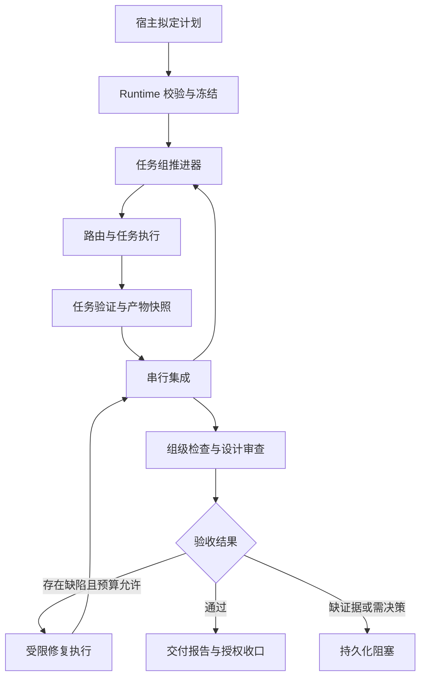

# Zoe 任务组自动研发与设计验收：版本开发详细设计

- 文档版本：1.0；日期：2026-10-30。
- 版本代号：Task Group Delivery（TGD）；运行时语义版本在基线盘点后确定，不覆盖或冒用此前 v1.1/v1.2 路由提案的版本号。
- 状态：待实施设计。本文不是开发完成、平台验证通过或发布证明。
- 适用产品：zoe-workflows 通用 Skill + zoe-runtime Python CLI（命令名 zoe）。
- 默认环境：macOS、Windows，本地安装的编码 CLI；不要求 Linux 或 Docker。
- 输入依据：本轮关于自动拆分、规则路由、自动执行、设计一致性验收的讨论，以及 F1—F8 修复 v2 的用户摘要与已拍板决策。未获得覆盖后 v2 全文及当前源码，因此文件名、扩展点为逻辑建议，实施时必须映射到实际基线。

## 1. 版本目标与范围

### 1.1 用户目标

用户提供设计文档，并指定项目与批准范围，Zoe 自动拆分任务、选择可用执行组合、按依赖执行、处理允许的修复、验证设计覆盖，并生成对应同一最终代码版本的交付报告。

产品承诺：一次发起、持续推进、可中断恢复、按设计验收。不能保证所有项目在一个聊天会话内完成，也不能保证机器休眠或关机期间继续执行。聊天会话不是任务权威状态源。

### 1.2 本版必须交付

1. F8/F1/F2 等影响基础交付的修复完成并有回归记录。
2. 一个项目、一个仓库内的持久化任务组和静态依赖图。
3. 宿主辅助拆分，Runtime 进行结构、授权、覆盖和依赖校验。
4. 批准范围内的执行 profile 规则路由；记录模型请求与实际观测。
5. 本地持续推进进程；默认串行，具备经过测试后启用的有限并行。
6. 任务产物快照、串行集成、组级设计验收和受限修复。
7. 暂停、恢复、取消、外部收口、可读进度与完整交付记录。
8. Skill 与 Runtime 的兼容声明、打包与安装验证。

### 1.3 不在本版实现

动态自我改写 Skill、提示词竞赛与 Harness² 递归优化；根据少量样本自动学习模型排名；任意递归生任务；跨仓库任务图；分布式调度与消息队列；自动扩大权限；自动降低验收标准；容器隔离；无人批准的主分支合并。

不得以“默认有测试”或“模型说完成”替代验收。首版只在事先批准的任务图内推进；新需求需要新的计划修订。

## 2. 角色、边界与设计原则

| 角色 | 负责 | 不负责 |
|---|---|---|
| Skill／WorkBuddy／OpenClaw | 需求消歧、拟定计划、解释报告、必要时询问用户 | 把聊天记录当数据库、绕过 Runtime 直接修改任务状态 |
| Runtime | 配置校验、冻结快照、调度、归属、预算、恢复、证据、Git 集成与发布 | 猜测业务要求、凭 LLM 评分取消硬门禁 |
| 编码 Agent | 在任务 worktree 中实现、运行自检、输出结构化结果 | 修改任务账本、主分支、授权和验收规则 |
| 验证工具／审查 Agent | 对固定产物运行检查、指出设计偏差 | 自行宣布任务组 DONE、改写验收标准 |
| 用户或既有授权主体 | 批准范围、需求变更、需要人工的验收与发布 | 逐次批准已授权的普通执行 |

原则：单一任务单一有效执行者；所有决策绑定 project/group/task/run；最终验收绑定最终集成 SHA；已执行次数不抹除；失败事实不可覆盖为成功；授权范围只能显式变更。

本地 worktree 是文件与分支隔离，不是操作系统安全沙箱。同一用户运行的 CLI 若可访问宿主文件，不能承诺阻止恶意执行。控制器独占发布在本版属于执行协议、凭据配置与事后检测共同保障的边界，不夸大为内核强制隔离。

## 3. 总体架构



推进器不需要常驻 LLM。确定性循环调用已有 start/status/reconcile 等内部服务；规划或语义审查由显式的 Agent 阶段执行。宿主退出后，已冻结计划仍可由本地监督进程推进。不存在受支持的后台启动方式时，提供前台运行并如实提示，不能把聊天轮询冒充无人值守。

## 4. 基线盘点与前置修复

开始开发前生成 baseline.json：源代码 commit、安装版本、Python 版本、DB schema、API/protocol 版本、平台、现有适配器能力。版本未知留空并标记未核实，禁止从旧设计文档推断。

### 4.1 F8 版本对齐

构建 wheel/sdist，在干净环境安装；分别验证裸 zoe、Skill 包装器、机器可读 capabilities 指向同一运行时。安装与公开发布分开记录。不增加版本漂移绕过变量，不以源码路径回退作为用户安装方案。

### 4.2 F1 重绑策略后只重验

保留 revalidation.product，内容至少包括产物 SHA、完整工作区指纹、关联任务与 assignment revision；since_policy 记录首次失效策略，另记本次采用的策略。重复 rebind 沿用同一产物基准。**首次** rebind 的基准取自已签发的证据（`validated_sha`/`validated_fingerprint`），不取自当前工作树——否则"先改文件再 rebind"会把人为改动洗成被验证的产物；只有从未签发过证据时才退回 `candidate_sha` + 当前树。

只有无活跃执行、产物身份一致且新策略仍允许此产物时，进入 READY/verify。对产物执行新的范围检查与验证，不能仅更新摘要。PROCESS_UNKNOWN 不清除。last_block 用于留档，不代替当前阻塞事实。实际已发布状态须对账；本地产物 acceptance 与 PR 的 ci 阶段按当前代码契约分别处理。

### 4.3 F2 预算与恢复

attempts 单调记录实际实现启动次数；budget_waivers 以 task_id/run_id 唯一，记录原因、证据引用、作出决定的主体，和状态变更同事务提交。有效实现预算消耗为 attempts 减有效豁免数；豁免不能超过已记录次数。历史任务默认不自动追溯豁免。

配置故障按证据分类。Spec 要求路径不等于已授权；AC 未引用检查不等于该检查可忽略。认证/环境问题重新预检，不强制改变策略摘要。同一未修复阻塞不重新派发。

越界发生在实现末尾时，本版不新增 skip_implement：恢复时保留已有产物，按实际原因生成增量修复 prompt。执行次数、实际资源消耗仍保留，另设任务组真实启动总上限，防止豁免造成无限运行。

### 4.4 F3—F7 必要条件

PASS/FAIL/NOT_VERIFIED 三态；NOT_VERIFIED 保存记录但不能生成验收通过证据。无测试不直接等于配置错误。路径检查先保护规则再允许规则，完整返回越界列表；扩权与还原是不同修复路径。auth_mode 属于 profile，unknown 不视为成功；显式必需 credential_refs 不静默变成可选。按交付模式提供模板，注册回显策略差异及影响任务。repair 建议仅供解释，不作为任意 shell 执行输入。

## 5. 需求冻结与任务拆分

### 5.1 输入与处理

输入包含设计文件列表、项目、目标基线 commit、交付模式和范围。读取所有本期设计材料，对每个文件保存内容摘要；生成一个设计清单摘要。文档中的命令、建议、示例不构成权限授权。

宿主提取需求 REQ、验收条件 AC、架构约束 CON，并建立源文件与章节引用。不要求每次使用完全相同自然语言，但冻结后的 ID 与内容不可原地改写。

### 5.2 计划示例

```json
{
  "schema_version": 1,
  "project_id": "demo",
  "base_sha": "<resolved-commit-sha>",
  "design_digest": "<sha256>",
  "delivery_mode": "local_artifact",
  "tasks": [
    {
      "task_key": "export-contract",
      "depends_on": [],
      "requirement_ids": ["REQ-01"],
      "acceptance_ids": ["AC-01"],
      "expected_paths": ["src/export", "tests/export"],
      "task_type": "api",
      "requested_profile": null,
      "required_capabilities": ["non_interactive", "structured_result"],
      "check_ids": ["export-contract-test"]
    }
  ],
  "group_check_ids": ["integration"],
  "execution_policy": {
    "max_parallel": 1,
    "max_actual_starts": 12,
    "max_group_repairs": 2,
    "max_wall_seconds": 14400
  }
}
```

以上预算为示例，不是所有项目默认值。任务数、检查时长和实际启动预算由宿主结合规模生成，并由既有授权覆盖或在启动前一次确认。

### 5.3 校验规则

- task_key 唯一；依赖存在且无环；不允许跨项目引用。
- 每个本期 REQ 至少由一项任务覆盖，每项必需 AC 有验证方法和责任任务。
- 需求映射完整仅表示结构覆盖，不证明语义实现正确。
- 目录包含使用规范化路径与目录边界判断；拒绝绝对路径、父目录逃逸，处理 Windows 大小写规则、符号链接与重解析点。
- allowed_paths 按项目与任务授权交集计算；expected_paths 是规划提示，不能替代强制范围。
- 计划中有共享文件、接口或依赖变更时先串行，首版不按模型推测允许并行。
- 人工验收项必须明确；缺少自动检查不能伪装成自动验收。

计划生成后经过结构校验与一次固定清单的完整性检查。既有授权足够时自动进入 READY；不新增无必要确认。计划改变需求或权限时重新批准并生成 revision，不覆盖历史。

## 6. 执行组合路由

### 6.1 选择顺序

1. 以项目批准 profiles 与任务约束形成候选集合。
2. 校验 adapter、平台、非交互、输出协议、权限、模型固定能力。
3. 收集本次环境观测快照，包括 CLI 绝对路径与版本；认证未知不伪称可用。
4. 显式 profile 也走同样硬条件，仅跳过排序。
5. 精确 task_type 的 prefer 优先，其次 catch-all。偏好与可用集合无交集时进入 fallback，不能偷用 allowed_profiles 顺序。
6. 唯一可用候选可选择；多候选无偏好时返回待选择，或使用已批准且仍合格的默认 profile。

环境探测与纯决策函数分开。纯函数输入为冻结配置、任务约束、环境快照；重放返回已保存决策，不重新探测改写旧决策。

### 6.2 身份与观测

保存 profile_id、adapter_id、adapter_backend、execution_backend、CLI 路径/版本/可选二进制摘要、profile_digest、requested_model、reported_model、model_observation、assignment_revision。组合摘要覆盖规范化执行配置，不包含密钥值。

reported_model 仅说明工具报告，不自动成为强证明。无法识别实际模型记录 unknown。任务要求固定模型而执行器不能保证时排除；不以“最擅长前端”等无证据评价自动排序。

组启动可先预演全部路由；实际派发前重检已选择 profile。不可用时阻塞，默认不自动换人。用户显式 reassign 后新建 assignment revision，旧进程须确认停止，不向新工具传旧工具 session。

### 6.3 会话隔离

原生 session resume 仅在现有适配器能力经过验证且归属完全一致时使用，否则重建会话并传递结构化交接。绑定 project/task/worktree/adapter/profile revision；禁止 --last 或 --continue 推测会话。跨项目经验只允许显式批准的脱敏通用规则，不检索其他项目的原始日志。

## 7. 数据模型与持久化

复用已有 tasks、runs、events、operations 和 evidence。以下为逻辑实体，可按实际数据库形式映射；禁止为了本版复制全部任务表。

| 实体 | 核心字段 | 约束 |
|---|---|---|
| task_groups | group_id/project_id/state/revision/plan_digest/design_digest/base_sha/integration_sha/policy_snapshot/lease_epoch | group_id 全局唯一 |
| group_members | group_id/task_key/task_id/dependency_keys/member_state/consumed_input_sha/integrated_sha | group_id + task_key 唯一 |
| group_checks | group_id/check_id/subject_sha/design_digest/status/evidence_ref | 结果只针对明确版本 |
| 集成操作记录（可复用 operations） | operation_id/member_revision/base_sha/candidate_sha/result_sha/status | 幂等，保存预期和实际 ref |

新增三类逻辑数据即可；事件与幂等操作使用现有机制。路由快照可以作为任务 artifact 保存，其完整摘要写入权威记录。

建议产物布局：

```text
ZOE_HOME/projects/<project_id>/groups/<group_id>/
  plan-r001.json
  requirements.json
  design-manifest.json
  routes/<task_key>-a001.json
  integration/<operation_id>.json
  reviews/<subject_sha>.json
  reports/progress.md
  reports/delivery.md
```

JSON/数据库是权威记录；Markdown 是可重新生成的视图。原始 Agent 输出、检查结果和宿主加工摘要分开保存；摘要带来源 run/event/evidence 引用，不得把自述升级成已验证事实。

### 7.1 原子性与崩溃一致性

不可变 artifact 先写临时文件、校验摘要、原子更名，再在数据库事务中提交引用、事件和操作结果。文件已写但 DB 未提交时为孤立 artifact，恢复时可按操作 ID 核对；DB 引用缺文件时阻塞，不假装无路由。

request_id 在 project + operation 命名空间唯一。同 ID 同输入返回原结果；不同输入拒绝。持久化失败结果重放不重新调用 Agent，修正输入使用新 ID。

Git 副作用无法与数据库同事务，使用“写意图→执行→对账→完成”协议，不声称 exactly-once 外部调用。

## 8. 状态机与依赖语义

### 8.1 任务组状态

| 状态 | 含义 | 允许后续 |
|---|---|---|
| DRAFT | 计划未冻结 | READY/CANCELLED |
| READY | 可推进，无运行监督器或待开始 | RUNNING/PAUSED/CANCELLED |
| RUNNING | 执行、集成或验证中 | BLOCKED/PAUSED/REVIEW_READY/CANCELLED |
| BLOCKED | 没有可推进工作，存在明确阻塞 | RUNNING/PAUSED/CANCELLED |
| PAUSED | 不再派发，现有执行按暂停策略处理 | RUNNING/CANCELLED |
| REVIEW_READY | 必需自动检查通过，待既定验收 | DONE/RUNNING/CANCELLED |
| DONE | 对最终 subject 完成全部必要验收 | 终态，不原地重开 |
| CANCELLED | 流程终止，可含 external_close 原因 | 终态 |

只有部分任务阻塞且还有独立任务可执行时，组仍为 RUNNING，并展示阻塞数量。暂停确认不等于所有子进程已停止，响应须返回 active_run_ids 与 draining 标记。

### 8.2 成员与原任务状态分离

组成员记录 WAITING/EXECUTING/VALIDATED/INTEGRATED/BLOCKED。VALIDATED 是可供集成的产物里程碑，不把原任务提前改成 DONE。组成员任务不单独发布 PR；控制器保存已验证候选，组集成后统一交付。

如果现有 task 流程无法停在“验证通过但未发布”，必须增加内部 group_member 交付分支及契约测试；不能用模拟 task accept 解锁下游。

依赖满足条件为上游成员已 INTEGRATED 且产物未被失效。取消或外部收口不自动满足依赖。下游创建时冻结当前 integration_sha，并检查其中包含所有上游依赖产物。

### 8.3 恢复

恢复先检查监督器与 run 归属、活动进程、Git 操作意图、证据引用和策略；再决定可推进集合。身份未知保持阻塞，不能仅凭心跳过期重启。用户修复环境后重跑预检，禁止强制变更无关策略。

## 9. 推进器与资源预算

本版沿用当前进程监管设施，新增组级推进服务。一个 group 同时只有一个有权提交调度结果的监督器；租约包含 owner、进程身份、epoch。接管时旧 owner 的后续写入因 epoch 过期拒绝；接管不能绕过子任务进程对账。

```text
tick(group):
  reconcile existing runs and pending Git operations
  stop if paused, cancelled, policy changed or ownership unknown
  collect verified candidates; integrate serially
  select dependency-ready members
  enforce project/global/group concurrency and budgets
  persist dispatch intent; launch through existing task service
  if all members integrated: run final checks and review
  derive group state and regenerate readable progress
```

SQLite 事务内不运行长时间 CLI、Git 或模型调用。按已有全局锁序接入，不自行引入相反锁序；跨平台锁后端需使用已验证机制，不能把 Unix flock 当成 Windows 实现。

预算至少覆盖真实 Agent 启动次数、组修复轮数、单次超时、组累计运行时长；时长采用累计活动时长并保存检查点，不把机器休眠等同于计算执行。若另设日历截止时间，单独命名。费用缺失时标 unknown，不能将估算当硬性账单上限。

max_parallel 默认 1。并行上线必须验证副作用隔离；即使路径不重叠也可能修改共享锁文件或接口，规划只提供保守分组，不承诺完全无冲突。

## 10. Git 产物与组级集成

### 10.1 初始条件

解析并固定目标 base_sha，创建控制器拥有的组集成分支。不能直接写 main。发布前重新检查目标分支漂移；不自动 force push。

### 10.2 串行集成协议

1. 候选须通过任务检查，记录 candidate_sha 与源基线。
2. 写集成操作意图，包含当前 integration_sha、候选及其唯一操作 ID。
3. 在独立集成 worktree 应用候选变更，运行必要快速检查。
4. 成功后记录 result_sha，通过预期旧 SHA 条件更新组 ref，再完成 DB 对账。
5. 崩溃后比较旧、新 ref 与操作记录；吻合则补记完成，不重复应用；发现第三种状态则阻塞。

候选允许通过明确的 commit 范围或 patch 表达，但适配方式必须统一并记录来源，禁止重复 cherry-pick 已集成候选。Agent 意外产生额外提交时沿现有 ownership/extra-commit 门禁处理，不擅自吞并。

### 10.3 冲突及失败

集成冲突在隔离集成工作区保留诊断，不破坏已确认 integration_sha。在预先授权的范围和组修复预算内派发一个串行修复执行；不修改目标主分支。无法无歧义解决时阻塞用户处理。

并行候选基于旧集成版本时，可以尝试受控应用，但旧任务通过证据不能直接证明整合后正确；需重跑相关检查，最终所有必需组级检查都绑定最终 SHA。

如果上游修复会影响已经执行的下游，标记受影响成员结果需要重验；首版保守重跑组级全部必需检查，不做复杂的自动最小测试选择。

## 11. 与设计文档一致的验收

### 11.1 三层验证

| 层 | 输入 | 输出 |
|---|---|---|
| 任务检查 | 冻结任务 AC、候选 SHA、范围与检查配置 | 单任务 PASS/FAIL/NOT_VERIFIED |
| 设计一致性审查 | 冻结设计、最终 diff、需求映射、检查结果 | 逐条偏差与依据 |
| 集成验收 | 最终 integration_sha、必需集成及端到端检查 | 最终交付证据 |

审查 Agent 使用独立上下文，不把实现 Agent 的完成总结当事实。可使用同模型的独立会话，但不宣称统计独立；高风险场景可按配置使用不同 profile。审查仅产生结构化 findings，不直接改变授权或合并。

### 11.2 审查输出契约

```json
{
  "schema_version": 1,
  "subject_sha": "<integration-sha>",
  "design_digest": "<design-digest>",
  "items": [
    {
      "acceptance_id": "AC-06",
      "status": "FAIL",
      "finding": "普通用户仍可调用导出接口",
      "locations": ["src/export/handler.ts"],
      "evidence_refs": ["check:permission-denied"],
      "suggested_action": "补权限判断并重跑权限测试"
    }
  ]
}
```

校验返回格式、全部必需 AC 是否出现、引用是否存在、subject 是否一致。非法输出为审查失败，不算通过。自动审查无法覆盖的体验、业务判断记录 NOT_VERIFIED 或等待指定人工检查。

FAIL finding 经规则可执行性检查后进入修复；有争议的纯语义判断可请求人工裁决，不允许为消除 finding 而改低需求标准。

### 11.3 证据与最终通过条件

证据包含 subject_sha、design_digest、plan_revision、policy_digest、check 定义摘要、环境摘要、结果、时间、原始日志引用。内容摘要用于一致性，不宣称同用户可写环境中不可伪造。

REVIEW_READY 必须满足：所有必需成员已集成；最终版本全部必需自动检查 PASS；设计审查无未解决阻断项；人工项显式列出；没有缺失或失效证据。DONE 还必须满足既定人工验收与交付模式条件。若没有人工验收项且启动授权明确允许自动收口，可自动执行 accept；不能仅因 profile 有 accept 动作权限便推断获得批准。

PR 模式沿既有“合并后验收”契约：发布集成候选→检查真实 PR/CI→等待授权合并→确认目标产物。如果合并后的树与验证候选不同，必须对实际交付版本重新验证。不能把 PR 创建成功当 DONE。

## 12. 修复闭环与人工边界

| 问题 | 动作 | 是否调用编码 Agent |
|---|---|---|
| 登录、PATH、外部工具不可用 | 阻塞，环境修复后预检 | 预检前不调用 |
| 策略不一致 | 显式更新、rebind、重新校验产物 | 根据阶段决定 |
| 实现末尾越界 | 汇总全部路径，选择批准范围或撤销越界，再增量执行 | 本版调用，不 skip |
| 必需产品测试失败 | 附明确失败证据修复 | 调用，计修复预算 |
| 设计存在重大歧义 | 生成一个聚合问题 | 等待用户 |
| 集成冲突 | 隔离修复；无法确定则暂停 | 在授权预算内调用 |
| PROCESS_UNKNOWN | 对账原执行 | 不创建新执行 |
| 达到总预算 | 保存现场和建议 | 不继续 |

组级修复作为同组下的有界 repair run 保存 parent finding、受影响任务、范围和预算，不开放无限动态任务图。新增需求必须 plan revise，不伪装为 bug 修复。

## 13. 外部收口与历史任务

external_close 复用 CANCELLED，记录 close_reason、外部动作、commit/PR 引用、操作者、时间、核实状态（declared/verified）和说明。只在确认无活跃执行后允许关闭，不能绕过 PROCESS_UNKNOWN。

展示“外部收口（未通过 Zoe 验收）”，不计入成功率，不解锁本组依赖，不允许 resume。后续继续工作创建关联任务。历史 W01/W02/W05 如已手工合并，先只读对账，用户选择外部收口后记录事实，不补造过去的验收证据。

## 14. CLI 与宿主协议

以下命令均为本版拟新增，不代表当前已存在。CLI 文档和 capabilities 同步发布。

| 命令 | 作用 | 副作用 |
|---|---|---|
| zoe group plan --request-file plan.json | 校验计划、需求覆盖与路由预演 | 不创建任务、不启动 Agent |
| zoe group create --request-file create.json | 冻结任务组 | 写记录与快照 |
| zoe group start ID --request-file start.json | 启动推进器 | 有界启动执行 |
| zoe group status ID --json | 查询状态与游标 | 默认只读 |
| zoe group status ID --refresh --json | 显式对账 | 允许更新状态，不派发新任务 |
| zoe group pause ID --request-file pause.json | 停止新派发，默认 drain | 活跃执行可继续至安全结束 |
| zoe group resume ID --request-file resume.json | 预检、接管并恢复 | 对账后派发 |
| zoe group report ID --format markdown | 渲染交付视图 | 可写可再生报告 |
| zoe group accept ID --request-file accept.json | 授权验收 | 通过门禁后 DONE |
| zoe group cancel ID --request-file cancel.json | 停止并关闭或外部收口 | 等待停止确认后终态 |

计划修订与成员 reassign 首版可复用内部服务并提供明确请求类型；不能用编辑数据库替代。未实现的命令标 planned，不在 runnable capabilities 中宣称可用。

响应统一复用现有 envelope，增加 group_id、revision、state、progress、blockers、next_actions、event_cursor。未知字段兼容按现有协议核定，新增语义必须协商能力。

状态与执行失败尽量复用现有错误码，通过 details.kind 区分 cycle、coverage_missing、dependency_failed、integration_conflict 等；不创建同义错误码。输入错误、策略拒绝、环境问题、执行失败保持不同可恢复语义。

## 15. Skill 改造与用户体验

Skill 仓库保留根 SKILL.md、references、薄包装脚本；不恢复 integrations 层，不捆绑 Python 源码。Runtime 独立仓库通过包管理安装。

建议新增参考文档：group-plan-schema、routing-policy、design-review-rubric、group-recovery、delivery-report。SKILL.md 只描述入口、步骤、权限与必要引用，不塞全部实现细节。

宿主流程：读取设计→生成计划→预演→在既有授权内冻结并启动→按事件查询→处理需用户的问题→呈现交付报告。不得宣称会话结束后宿主仍在轮询；只有后台 Runtime 确认已启动才能称持续推进。

进度摘要示例：

> 6 项任务：已集成 3，执行中 1，等待依赖 1，阻塞 1。阻塞原因：登录失效；其他独立任务继续。当前集成版本 abc123，最终验收尚未运行。

交付报告包含需求覆盖表、任务与执行组合、最终 SHA、检查结果、设计偏差、未验证项、实际启动/修复次数、外部收口和下一步。宿主可以加工语言，但不能改 Runtime 状态；加工摘要附来源游标。

## 16. 安全、审批与多项目隔离

所有查询、操作与文件路径必须从已解析 project_id/group_id 派生，不信任 Agent 自报 ID。每个项目独立 worktree、session 绑定、报告与证据命名空间；全局并发额度只共享计数，不共享业务上下文。

approved_by 是审计字段，不是授权机制。单用户本地模式记录宿主声明来源及授权范围，不声称具备企业身份认证。授权请求绑定 plan_digest/policy_digest 和具体扩权范围，旧批准不能用于不同计划。

检查命令、Skill 和仓库文件可能执行代码；只运行批准项目中的检查定义，使用参数数组与 stdin，不把 Agent 输出拼成 shell。原始日志限制大小、脱敏后展示；密钥值不写入摘要。保护路径规则始终优先。

## 17. 模块与实现任务

按实际源码合并，以下是建议职责，不要求每行都创建新文件：

| 工作包 | 主要实现 | 依赖 |
|---|---|---|
| W0 | 基线盘点、F8 安装对齐、F1/F2 修复 | 无 |
| W1 | group schema、计划校验、需求映射、迁移 | W0 |
| W2 | 纯路由函数、观测快照、组合身份 | W1，已有路由可复用 |
| W3 | group_member 验证里程碑、监督器、恢复与预算 | W1/W2 |
| W4 | 串行集成与 Git 操作对账 | W3 |
| W5 | 最终检查、设计审查、证据失效与修复循环 | W4 |
| W6 | Skill 流程、报告、外部收口、跨平台打包 | W3/W5 |
| W7 | 故障注入、真实 CLI 试运行、发布门禁 | 全部 |

先通过默认串行端到端，再启用有限并行。每个工作包应提交实现、必要测试、CLI/schema 文档和迁移说明，避免“代码先行、契约以后补”。不在未盘点源码时承诺固定几天完成。

## 18. 测试矩阵与验收用例

| ID | 场景 | 必须断言 |
|---|---|---|
| T01 | 正常三任务链 | 一次 start 推进至最终验收；全部指向最终集成版本 |
| T02 | 依赖环／缺失 AC 映射 | 派发前拒绝，无 Agent 启动 |
| T03 | 显式/default profile 越权 | 与自动选择同样拒绝 |
| T04 | prefer 全失效、两个其他候选 | fallback=ask 时不猜选 |
| T05 | 模型观测未知 | 不伪报固定模型，不进入未知模型质量排名 |
| T06 | 重复 create/start 请求 | 同输入重放，无重复任务与执行 |
| T07 | 监督器崩溃，子 Agent 存活 | 接管对账，不重复派发 |
| T08 | 启动握手未知 | 保持 PROCESS_UNKNOWN |
| T09 | artifact 写入后 DB 提交前崩溃 | 可对账孤立文件，无假完成 |
| T10 | Git ref 已更新而 DB 未提交 | 补记集成，不重复应用候选 |
| T11 | 连续两次 rebind | 产物基准仍在，只重验的任务不重启 Agent |
| T12 | waiver 提交前后崩溃 | 每 run 最多一项有效豁免，attempts 单调 |
| T13 | 认证修复，策略未变 | 可重新预检恢复 |
| T14 | Agent 删除测试后无测试 | 不直接认定配置责任，不 PASS |
| T15 | 保护路径与范围同时命中 | 优先保护，不建议扩权 |
| T16 | 上游变化、下游旧结果 | 标记失效；最终检查重新运行 |
| T17 | 两候选各自通过但集成失败 | 不进入 REVIEW_READY |
| T18 | 设计审查漏 AC／伪证据引用 | 输出无效，不接受审查 |
| T19 | pause/cancel 时有活跃执行 | 不抢先终态；明确 drain 与停止状态 |
| T20 | external_close | CANCELLED，不计成功，不满足依赖 |
| T21 | 两项目同 task_key/不同 session | 路径、会话、证据不串用 |
| T22 | 预算耗尽、连续豁免 | 实际启动总上限仍有效 |
| T23 | PR 合并树与候选不同 | 对实际产物重新验证 |
| T24 | wheel/Skill 干净安装 | 无源码目录仍能调用兼容 Runtime |

测试分层：纯算法单测；fake CLI 进程集成；精确故障点的子进程注入；macOS/Windows 平台测试；真实 Agent 端到端。fake CLI 不能算真实 Agent VERIFIED。

本版默认平台为 macOS、Windows，平台未实测标 NOT_RUN。宣称支持某执行组合时记录 OS/架构、CLI 版本、认证模式、模型配置、测试 commit 和证据。至少一个真实组合通过才可试用发布；若宣称跨 Agent 自动派发，至少两个不同 Agent 的真实组合通过。不能用 macOS 成功推出 Windows 成功。

## 19. 迁移、兼容与发布

1. 获取维护屏障，确认无活跃写操作，使用既有备份与完整性检查机制。
2. 添加组级数据结构，旧 task 无 group_id 时行为保持不变。
3. 新能力字段默认缺失而非自动注入旧策略，以免无故改变 policy digest。
4. 迁移版本根据真实 schema 基线递增；不得在未核实时硬写 v3→v4。
5. 双仓独立版本：Skill 声明最低兼容协议与 required capabilities；Runtime 返回真实支持范围。
6. 构建并检查 wheel/sdist；在不含源码仓库的环境验证 pipx 安装、升级与包装器。
7. 发布记录包含运行时/Skill commit、产物摘要、迁移版本、已验证矩阵及已知限制。不同仓库使用关联发布记录，不要求“同一个 commit”。

回滚优先关闭新任务组入口、保留已运行组的兼容运行时。禁止旧运行时打开不支持的新 schema；需要数据库恢复时先停止全部执行，备份新状态并对账 Git 副作用。不能只恢复数据库就声称回滚了外部提交或 PR。

## 20. 与 Harness² 的关系及后续扩展

本版做受约束研发交付，借鉴“以执行证据改进”的方法，不移植其递归优化主循环。后续可在独立实验区提出 prompt/Skill 改进，比较固定任务集上的效果，并显式采用版本；不得修改生产任务授权、需求和通过标准以提高通过率。

参考项目：https://github.com/google-research/harness2 。本轮此前已核对官方 README；本设计不依赖其当前安装环境、基准执行器或协议，也不宣称已经集成。

## 21. 发布完成定义

全部满足后才标记本版交付：

- [ ] F8/F1/F2 基础修复及恢复反例通过。
- [ ] 静态任务图能无人逐项催促地持续推进，宿主会话退出不丢权威状态。
- [ ] 路由在批准集合内，显式路径不绕过约束，选择有可读依据。
- [ ] 监督器恢复不重复执行；Git 中断可对账；未知执行不启动第二个 Agent。
- [ ] 任务局部通过与组级最终通过分离，最终报告绑定同一交付版本。
- [ ] NOT_VERIFIED、外部收口、缺失证据不会进入成功统计。
- [ ] 必需测试、实际平台与真实 Agent 记录已附，未运行项诚实标注。
- [ ] 两仓安装与兼容流程通过，不要求用户下载 Runtime 源码才能安装 Skill。
- [ ] 已知限制写明：无 OS 沙箱保证、机器离线不执行、不保证任意设计都能自动完成。

本版最终用户体验：提供设计并批准范围后，Zoe 自动推进可执行任务；出现真实阻塞时返回原因和最小必要决策；所有完成结论均可追溯至需求、执行记录和最终产物证据。
